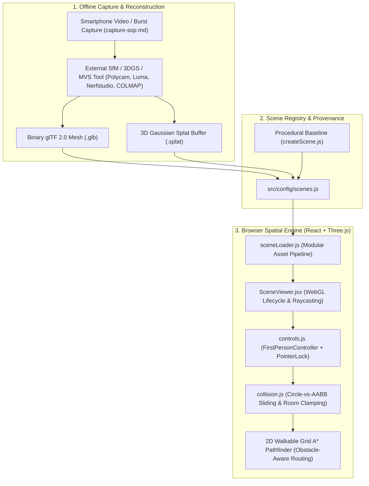

# System Architecture — Namma Space
## Indoor 3D Digital Twin & Spatial Navigation Platform

---

## 1. High-Level Architecture Diagram

---

## 2. Module Responsibilities

| File | Responsibility |
| :--- | :--- |
| [`src/config/scenes.js`](../src/config/scenes.js) | Single source of truth for scene definitions, asset paths, provenance metadata (`isReconstructed`), `roomBounds`, obstacle `colliders`, and searchable `pois`. |
| [`src/viewer/createScene.js`](../src/viewer/createScene.js) | WebGL stage initialization (`THREE.Scene`, `PerspectiveCamera`, `WebGLRenderer`, shadow-mapped lighting), procedural baseline geometry builder (`buildProceduralDemoRoom`), 3D POI beacon factory, A* route ribbon builder, and recursive GPU memory disposal (`disposeObject3D`). |
| [`src/viewer/sceneLoader.js`](../src/viewer/sceneLoader.js) | Modular loader supporting `mode: 'demo'`, `mode: 'glb'` (`GLTFLoader` + `DRACOLoader`), and `mode: 'splat'` (streaming 32-byte `.splat` parser + radial Gaussian shader kernel & `@mkkellogg/gaussian-splats-3d` compatibility). |
| [`src/viewer/controls.js`](../src/viewer/controls.js) | `FirstPersonController` wrapping `PointerLockControls` with normalized horizontal velocity (diagonal movement speed equals straight movement speed), standing height lock (`1.68m`), drag-to-look fallback, focus-loss safety reset, and cubic-eased POI camera transitions. |
| [`src/viewer/collision.js`](../src/viewer/collision.js) | `CollisionSystem` implementing outer perimeter wall clamping, 2-pass Circle-vs-AABB sliding collision resolution, wireframe collider visualization, and an 8-directional Octile-heuristic A* pathfinder with line-of-sight string-pulling. |
| [`src/viewer/SceneViewer.jsx`](../src/viewer/SceneViewer.jsx) | React bridge managing the `requestAnimationFrame` loop, window resize handling, dynamic scene switching, reticle raycasting against 3D POI markers, and telemetry emission. |

---

## 3. Round 2 Extension Architecture (Implemented & Extensible)

1. **Searchable Points of Interest (POIs):**
   - Each scene in `src/config/scenes.js` defines structured `pois` with 3D anchor coordinates (`position`), walkable approach coordinates (`waypoint`), and camera target (`lookAt`).
   - `Header.jsx` provides instant fuzzy search across POI names, categories, and descriptions.
2. **Obstacle-Aware Walkable A* Pathfinding:**
   - `CollisionSystem.computeObstacleAwarePath(startXZ, goalXZ)` discretizes the room's walkable floor into `0.20m × 0.20m` cells, expands every furniture AABB by `playerRadius + 0.06m`, finds the optimal 8-way path around obstacles, and applies line-of-sight smoothing so the rendered floor ribbon never cuts through walls or furniture.
3. **Future Mobile WebXR / AR Navigation Hook:**
   - Because all scene coordinates, collision bounds, and A* waypoints are expressed in 1:1 metric world meters (`Y = 0` floor plane), transitioning to a WebXR `immersive-ar` session requires only anchoring the scene origin to a physical QR/AprilTag fiducial at the room entrance (`spawn.position`).
