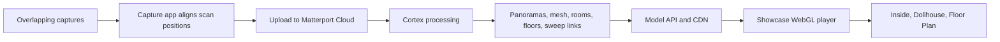

# Scaler campus tour and Matterport: research reference for Namma Space

Checked: 27–28 October 2026. Scope: the public Scaler School of Technology tour, Matterport's published technical material, and the Namma Space problem statement. This document records observed facts, cited provider claims, and design inferences. It does not contain Matterport's private source code or a copy of its model assets.

## 1. Executive finding

The [Scaler School of Technology page](https://www.scaler.com/school-of-technology/) embeds [Matterport model `vaq2aHbSqEJ`](https://my.matterport.com/show/?m=vaq2aHbSqEJ). [Digital Endeavours](https://www.digitalendeavours.net/matterport-india/) lists Scaler as a digital-twin project and hosts a [Scaler tour page](https://www.digitalendeavours.net/sst/) with location links. The observed roles are Scaler for the campus page, Digital Endeavours for the custom tour wrapper and location menu, and Matterport for model processing, hosting, and the browser viewer. The public record does not identify the capture camera, the person who scanned the campus, model ownership, or commercial terms.

The Scaler model combines **recorded panoramic viewpoints** with a **tiled 3D mesh**. The panoramas give Inside View its photographic detail. The mesh gives Dollhouse and transitions spatial structure. Movement in Inside View advances between linked scan positions called *sweeps*. This differs from the continuous first-person roaming required by the [Namma Space brief](https://techfest.org/media/compiProbStatement/Namma_Space.docx_2_compressed.pdf).

## 2. How the system works, end to end

1. **Capture.** An operator records overlapping views at successive locations. Matterport's Capture app aligns positions as data arrives. A depth camera can provide measured depth; other capture methods can need inferred depth. Matterport states that Cortex combines computer vision, image processing, deep learning, and spatial alignment. Imported 360° images can be treated as aligned 3D scans, while a standalone 360° View may remain unaligned and not add to Dollhouse geometry. Sources: [Cortex AI](https://matterport.com/cortex-ai), [360° import](https://support.matterport.com/s/article/Import-360-Spherical-Images?language=en_US), [outside scans and 360° views](https://support.matterport.com/s/article/Scanning-Outside-Paths-to-Guest-Houses?language=en_US).
2. **Cloud processing.** The operator [uploads the space](https://support.matterport.com/s/article/How-to-Upload-Your-Model?language=en_US). Matterport processes and hosts it in [Matterport Cloud](https://support.matterport.com/s/article/What-is-Matterport-Cloud-Workshop-and-3D-Showcase?language=en_US). Geometry and room segmentation can help [detect floors](https://support.matterport.com/s/article/Floor-Detection-Controls?language=en_US). The public material does not disclose the exact cloud reconstruction algorithm used for Scaler.
3. **Editing.** In Matterport Edit Mode, an editor can set the [start position](https://support.matterport.com/s/article/How-to-set-the-Start-Location?language=en_US), hide scans, add tags, and create a guided tour. [Dollhouse trim](https://support.matterport.com/s/article/How-To-Use-Dollhouse-Trim?language=en_US) changes which mesh areas appear; it can also remove blocked navigation paths. These edits affect presentation and available movement.
4. **Delivery.** The site embeds [3D Showcase](https://support.matterport.com/s/article/What-is-Matterport-Cloud-Workshop-and-3D-Showcase?language=en_US). The browser receives model metadata, viewer code, panorama images, mesh tiles, and textures. It renders into a canvas with WebGL. The page can use URL parameters to select a start sweep and view direction.

## 3. What the Scaler browser trace shows

A controlled Chrome run loaded the public model and switched to Inside View. The HTML included a preloaded model record. Its structural data showed **665 panorama positions**, **3 floors** (Upper Basement, Ground Floor, First Floor), and **67 room records**. Each position had a 3D location, panorama information, and neighbor IDs. The first trace recorded 1,040 browser events with no dropped events, but it ended while some network requests were still active. The position, floor, and room counts come from the preloaded record, not the number of completed downloads.

| Browser data or request | Observed role |
| --- | --- |
| `my.matterport.com/show/?m=vaq2aHbSqEJ` | Viewer page and model entry point. |
| `my.matterport.com/api/mp/models/graph` | GraphQL requests, including `GetModelViewPrefetch`, `GetSnapshots`, and `GetRoomBounds`. |
| `static.matterport.com/showcase/26.10.3_webgl-1665-gab190a4967/` | Showcase scripts and styles. |
| `static.matterport.com/webgl-vendors/three/0.184.0/` | Three.js modules used by the viewer. |
| `cdn-2.matterport.com` JPEG cube-face tiles | Panorama imagery at several resolution levels. The record includes tile templates and 512-pixel tiles at one resolution. |
| `cdn-2.matterport.com` tile manifest, `.glb` chunks, `.ktx2` files | Tiled mesh and texture assets. |
| `events.matterport.com` | Viewer usage events. |

The model record also declared one available Matterport `.dam` mesh at a `50k` resolution label, two JPEG texture assets, one tiled set, and **no declared splat assets**. This says only what this model snapshot declares. It does not say that the Matterport platform never uses splats. The trace did not inspect the proprietary `.dam` format.

The viewer imported Three.js and used a canvas. A static scan of public, minified Showcase JavaScript found rendering-related symbols, but that scan was partial. The network trace is stronger evidence for the shipped formats than a guess about the internal rendering code. A `.glb` file is a [binary glTF container](https://registry.khronos.org/glTF/specs/2.0/glTF-2.0.html). A `.ktx2` file is a [GPU texture container](https://threejs.org/docs/pages/KTX2Loader.html). [Three.js GLTFLoader](https://threejs.org/docs/pages/GLTFLoader) can load glTF assets and use a KTX2 loader for compressed textures; this format capability does not prove Showcase uses that exact loader implementation. [Three.js WebGLRenderer](https://threejs.org/docs/pages/WebGLRenderer) documents WebGL-based rendering.

**Trace references:** initial browser capture `ev_a41b5a54c98950ed18f63335ff3250eb8a0cca02d7ee20db8c675301ffb1f311`; Inside View switch `ev_4ad5988dac9bb93dd90c6293fe75d530994526c5c90142d5cb8b7137c6922852`; static JavaScript summary `ev_278496bbea001d4f95261c1b7ead5d5caa360e14b1c1c9a92c566885ff35b19b`; prior Scaler embed capture `ev_8b7332ded8b664c89c06a003d3abff0174534d0df4b67654c96fe7c9aa85b208`. These are local REA evidence identifiers, not public web links. No signed CDN URL, temporary token, or full embedded model payload is copied here.

## 4. Rendering and navigation

**Inside View:** The camera sits at a captured sweep. The viewer displays panoramic imagery for that position and requests image tiles as needed. Matterport says the photographic result comes from [projecting panoramas](https://support.matterport.com/s/article/Download-the-MatterPak-Bundle?language=en_US). Mesh geometry supports spatial transitions. The exact projection shader, blend rule, and tile selection policy were not visible in the trace.

**Dollhouse View:** The player displays the scanned building as a textured 3D form. The observed mesh chunks and texture files support this view. Matterport describes the [MatterPak mesh](https://support.matterport.com/s/article/Download-the-MatterPak-Bundle?language=en_US) as a Dollhouse-like export and distinguishes it from the panorama-based photographic experience. The live player may use a different internal mesh representation than an export.

**Floor Plan View:** The player provides a top-down spatial view and floor selection. The Scaler record declares three floors. The trace did not isolate whether each displayed layer is a live mesh view, a generated image, or a mix.

**Sweep movement:** The [Matterport Sweep SDK](https://matterport.github.io/developer-docs/reference/sweep/) exposes positions and neighbors. The [Camera SDK](https://matterport.github.io/developer-docs/reference/camera/) states that `moveInDirection` moves to a different sweep in Inside View; the arrow keys behave the same way. The same documentation places `W`, `A`, `S`, and `D` pan controls in Dollhouse or Floor Plan View. It does not describe continuous first-person walking between arbitrary points in Inside View. The [Showcase help screens](https://support.matterport.com/s/article/Help-Screens-inside-3D-Showcase?language=en_US) show separate controls for these views.

**Routes:** The SDK can form a graph of enabled sweeps and run [A* pathfinding](https://matterport.github.io/developer-docs/tutorials/pathfinding/). Its edge weights are distances between neighbor sweeps. A route through that graph is a sequence of scan positions. It is not automatically a walkable floor surface with continuous clearance and collision checks. No active route-guidance feature was demonstrated in the Scaler tour capture.

**Location links:** Digital Endeavours' Scaler page contains nine location links. One observed Innovation Lab example selected the same model with `m=vaq2aHbSqEJ&ss=1&sr=-.01,-.92`. The `m`, `ss`, and `sr` values identify a model, a start sweep, and view direction in these observed links. This is useful for direct jumps to points of interest. The exact meaning of every URL parameter is subject to Matterport's current embed behavior.

## 5. Product requirements and implications for Namma Space

The [Techfest Namma Space problem statement](https://techfest.org/media/compiProbStatement/Namma_Space.docx_2_compressed.pdf), pages 1–4, sets these stages. The [competition page](https://techfest.org/competitions/nammaspace) supplies the official competition context.

| Stage | Required result |
| --- | --- |
| Round 1 | Define a phone capture procedure; automatically reconstruct a photorealistic indoor model; provide a browser viewer with fluid first-person WASD and mouse movement; submit the abstract, live link, short demo, repository, setup steps, and sample data. |
| Round 2 | Add clickable points of interest, spatial search, jump-to-location, and desktop routes that remain on floors and avoid walls and furniture. |
| On-site final | Capture a new venue, process it, add points of interest, and deploy the viewer in one day; demonstrate and answer questions the next day. |
| Bonus | Phone-camera AR directions. Desktop navigation remains mandatory. |

The brief permits credited third-party tools and existing depth or stitching methods. It requires original work and license compliance. A Matterport iframe is a useful reference for image quality, scan alignment, progressive delivery, spatial views, and direct location links. It does not, on its own, meet the brief's continuous roaming or floor-safe routing requirements.

For Namma Space, keep four outputs in one coordinate system: a photographic scene, a walkable floor and collision model, searchable points of interest, and a route graph or navigation mesh. The browser camera should move continuously, obey collision bounds, and follow or display paths that clear obstacles. The current NammaSpace repository documents its own [architecture](architecture.md), [capture procedure](capture-sop.md), and [reconstruction workflow](reconstruction-workflow.md). Those project documents describe the implementation and should be validated against a new real capture; they are separate from the observed Matterport system.

## 6. Complete link and reference register

The following links were consulted or identified during this investigation. They are grouped by what they support. Links to vendor pages record vendor claims. The browser trace supplies the direct observations above.

| Reference | Use in this report |
| --- | --- |
| [Scaler School of Technology](https://www.scaler.com/school-of-technology/) | Campus page and tour embed. |
| [Scaler Matterport model](https://my.matterport.com/show/?m=vaq2aHbSqEJ) | Public viewer examined. |
| [Digital Endeavours projects](https://www.digitalendeavours.net/matterport-india/) | Scaler project attribution. |
| [Digital Endeavours Scaler tour](https://www.digitalendeavours.net/sst/) | Custom location menu and iframe. |
| [Techfest Namma Space PDF](https://techfest.org/media/compiProbStatement/Namma_Space.docx_2_compressed.pdf) | Product requirements. |
| [Techfest competition page](https://techfest.org/competitions/nammaspace) | Official competition context. |
| [Matterport Cortex AI](https://matterport.com/cortex-ai) | Vendor's capture and spatial-processing description. |
| [Upload your space](https://support.matterport.com/s/article/How-to-Upload-Your-Model?language=en_US) | Upload and processing workflow. |
| [Floor detection controls](https://support.matterport.com/s/article/Floor-Detection-Controls?language=en_US) | Floor grouping and geometry. |
| [Import 360° images](https://support.matterport.com/s/article/Import-360-Spherical-Images?language=en_US) | Aligned 360 capture and depth inference. |
| [Matterport Cloud, Edit Mode, and Showcase](https://support.matterport.com/s/article/What-is-Matterport-Cloud-Workshop-and-3D-Showcase?language=en_US) | Hosting, editing, and player roles. |
| [Assets available for download](https://support.matterport.com/s/article/Matterport-Assets-You-Can-Download?language=en_US) | Panorama, depth, mesh, and export context. |
| [MatterPak bundle](https://support.matterport.com/s/article/Download-the-MatterPak-Bundle?language=en_US) | Mesh versus panorama fidelity. |
| [High-quality Showcase tips](https://support.matterport.com/s/article/Tips-for-Creating-a-High-Quality-3D-Showcase?language=en_US) | Capture spacing and visual quality. |
| [Outside scans and 360° views](https://support.matterport.com/s/article/Scanning-Outside-Paths-to-Guest-Houses?language=en_US) | Aligned versus unaligned panorama behavior. |
| [Dollhouse trim](https://support.matterport.com/s/article/How-To-Use-Dollhouse-Trim?language=en_US) | Mesh visibility and blocked routes. |
| [Start location](https://support.matterport.com/s/article/How-to-set-the-Start-Location?language=en_US) | Initial view settings. |
| [Showcase help screens](https://support.matterport.com/s/article/Help-Screens-inside-3D-Showcase?language=en_US) | View-specific controls. |
| [Guided Tour best practices](https://support.matterport.com/s/article/Guided-Tour-Best-Practices?ardId=kA05d000001DX1kCAG&language=en_US) | Guided-tour design context. |
| [Matterport Pro3 FAQ](https://support.matterport.com/s/article/FAQ-Pro3-Camera?language=en_US) | Example of a depth-camera capture method; not evidence of Scaler's device. |
| [Matterport developer tools overview](https://support.matterport.com/s/article/API-SDK-Developer-Tools-Overview?language=en_US) | SDK and Showcase relationship. |
| [Matterport Camera SDK](https://matterport.github.io/developer-docs/reference/camera/) | Camera actions and movement limits. |
| [Matterport Sweep SDK](https://matterport.github.io/developer-docs/reference/sweep/) | Sweep data, neighbors, and graph. |
| [Matterport pathfinding tutorial](https://matterport.github.io/developer-docs/tutorials/pathfinding/) | A* on sweep graph. |
| [Showcase SDK site](https://matterport.github.io/showcase-sdk/index.html) and [Sweep module](https://matterport.github.io/showcase-sdk/docs/reference/current/modules/sweep.html) | Additional developer reference. |
| [Khronos glTF 2.0 specification](https://registry.khronos.org/glTF/specs/2.0/glTF-2.0.html) | `.glb` format definition. |
| [Three.js GLTFLoader](https://threejs.org/docs/pages/GLTFLoader), [KTX2Loader](https://threejs.org/docs/pages/KTX2Loader.html), and [WebGLRenderer](https://threejs.org/docs/pages/WebGLRenderer) | Format and WebGL background. |

## 7. Limits and open questions

The public trace establishes the browser-delivered data and observed viewer behavior in one session. It does not establish the original capture device, camera path, cloud model-training method, exact GPU shader, full model size, pricing, or permissions. Some network requests were still active when capture stopped. The static JavaScript was minified and its analysis was partial. To claim more about internal algorithms would require Matterport's own engineering disclosure or authorized source access.
